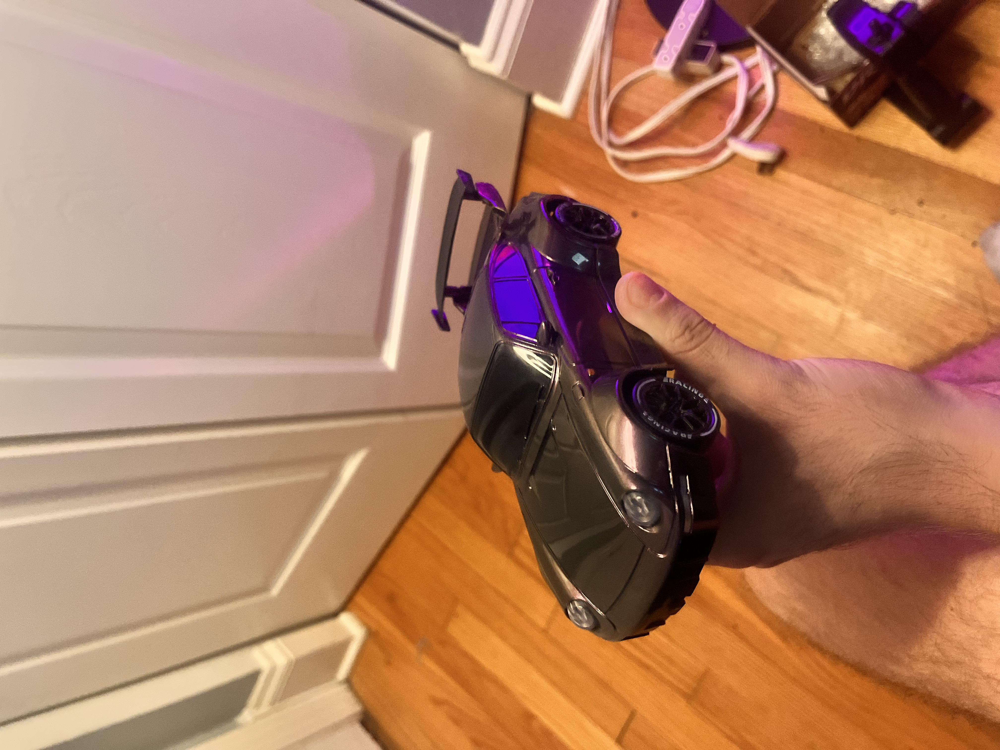
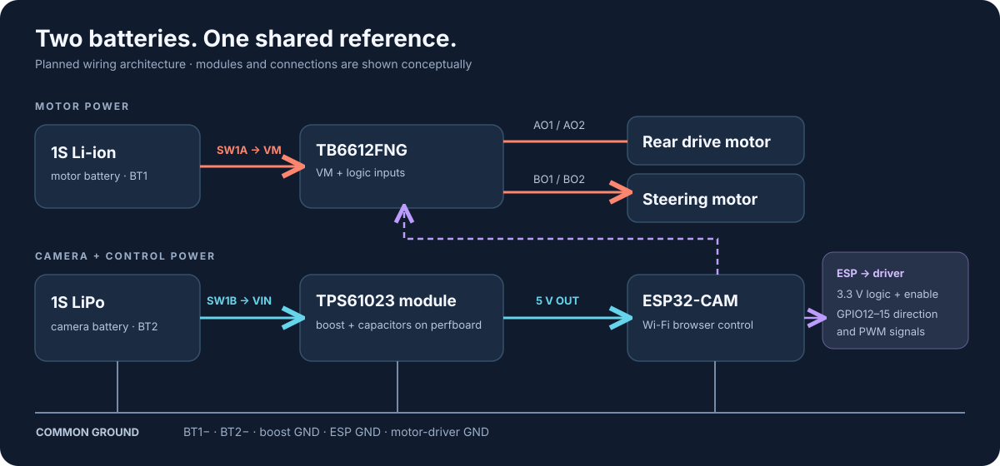
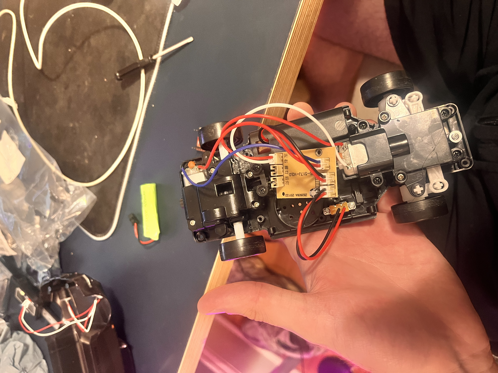

# FPV Simulator Car

### A toy RC car rebuilt around an ESP32-CAM, a dual motor driver, and a dedicated camera power rail

The goal is to turn a stock RC car into a first-person-view vehicle controlled from a browser. The current repository captures the chassis teardown, ESP32 motor-control firmware, and a two-battery wiring design. **FPV video and a simulator integration are goals, not completed features.**

| Area | What is here now |
| --- | --- |
| Chassis | Stock Porsche-style car inspected; rear drive and front steering motors identified. |
| Control firmware | ESP32-CAM Arduino sketch serves a local web controller over its Wi-Fi access point. It includes variable drive PWM, steering kick/hold behavior, a 700 ms command timeout, and a browser OTA update page. |
| Power architecture | Two independent 1S batteries: motor battery feeds the driver motor supply; camera battery feeds a TPS61023 5 V boost module. Negatives share a common ground. |
| Wiring | Editable DIY Layout Creator (DIYLC) project includes the off-board devices and the converter/capacitor perfboard on one canvas. |
| Still to validate | Final perfboard assembly, battery runtime, motor current and thermal behavior, ESP32-CAM supply stability, camera streaming, and driving video. |

## System at a glance

The ESP32-CAM's 3.3 V output provides the TB6612FNG's **logic supply and control-high rails** (VCC, STBY, PWMA, PWMB); the motor battery supplies **VM**. The batteries' positive rails remain separate. Their grounds connect so the ESP32 and driver share a logic reference. See the [wiring details](docs/hardware.md) for the pin map and capacitor placement.

## Repository map

| Path | Purpose |
| --- | --- |
| [`firmware/esp32_cam_tb6612_motor_test/`](firmware/esp32_cam_tb6612_motor_test/) | Current motor-control test sketch and flashing notes. No camera stream in this sketch. |
| [`hardware/RC_car_complete_system.diy`](hardware/RC_car_complete_system.diy) | Editable whole-system DIYLC layout, including the converter perfboard. |
| [`docs/hardware.md`](docs/hardware.md) | Power, signals, capacitors, and schematic limitations. |
| [`docs/bring-up.md`](docs/bring-up.md) | Incremental power-on and measurement checklist. |
| [`firmware/legacy/`](firmware/legacy/) | Earlier control and single-motor experiments retained as history. |
| [`assets/`](assets/) | Project photos and architecture illustration. |

## Control firmware

The current sketch targets an **AI-Thinker ESP32-CAM** using **Arduino-ESP32 3.x**. Set a local OTA password and select an OTA-capable partition scheme before the first serial flash. The sketch creates a Wi-Fi access point; connect a phone or laptop and open the IP address printed to Serial (typically `192.168.4.1`). Hold the on-screen buttons or use **W/A/S/D**; the drive slider adjusts rear motor PWM. Later builds can be uploaded through the authenticated `/update` page while the car is parked. See the [firmware instructions](firmware/esp32_cam_tb6612_motor_test/README.md).

The camera and microSD card are **not initialized**. GPIO12–15 are assigned to motor control, so microSD cannot be used with this pin map. GPIO12 is also an ESP32 boot strapping pin: if a connected driver prevents boot, isolate or revise that connection before considering the build complete. The [firmware notes](firmware/esp32_cam_tb6612_motor_test/README.md) describe the control behavior and known limits.

## Engineering decisions

- **Two power paths:** Motor load transients are kept off the camera boost converter's input path. This is an architectural choice; supply stability still needs measurement on the assembled car.
- **One reference ground:** Separate battery positives do not remove the need for a shared ground between the ESP32 and motor driver.
- **Control timeout:** The sketch commands both motors off when no control request arrives for 700 ms. A physical power switch is still required.
- **Perfboard for power distribution:** The TPS61023 module, input/output bulk and ceramic capacitors, and the 3.3 V logic rail are grouped on a dedicated board. The layout is a wiring guide, not a verified PCB footprint or solder-hole map.

## Next milestones

1. Match the actual TPS61023 module pads and perfboard dimensions to the DIYLC layout; assemble and inspect the power board.
2. Measure 5 V at the ESP32-CAM during Wi-Fi activity and motor starts; record battery voltage and peak motor current.
3. Demonstrate controlled forward/reverse and steering under load; log timeout and power-cycle behavior.
4. Add camera streaming without colliding with the motor PWM channels, then capture a short driving demo with measured results.

The original chassis and electronics are shown below. The stock receiver board was inspected as part of planning; the replacement architecture is documented in the DIYLC file.

Stock chassis and electronics

